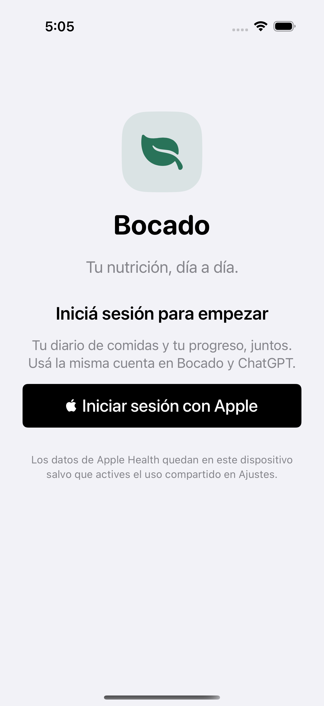
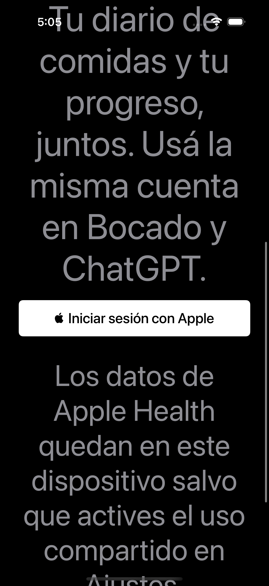

# Inicio de sesión obligatorio — 12 de octubre de 2026

La pantalla de entrada permite iniciar sesión con Apple antes de acceder al diario, Progreso o Ajustes. Una sesión vigente en Keychain permite entrar directamente. Cerrar sesión desde Ajustes o recibir un rechazo por sesión vencida vuelve a esta pantalla sin borrar el historial ni los originales de Apple Health.

Usa el botón nativo de Apple, español/inglés, modo claro/oscuro y contenido desplazable con Dynamic Type. Un error de conexión permite reintentar; el botón de Apple permanece deshabilitado hasta obtener el desafío del servidor.

## Capturas verificadas en iPhone 17 Pro Simulator

| Español, modo claro | Español, modo oscuro y texto de accesibilidad máximo |
| --- | --- |
|  |  |

## Validación

- 17 pruebas de sesión: restauración, expiración con el formato del backend, rechazo de sesión, logout, fallos de Keychain, caché y sincronización existentes.
- 5 pruebas UI del login: bloqueo del contenido con historial local, sesión guardada vencida, cancelar/cerrar sesión desde Ajustes, error/reintento de conexión y español claro/oscuro con texto grande.
- Regresión UI del historial guardado y reapertura aprobada.
- Compilación Release de Bocado para Simulator aprobada. La prueba visual final se ejecutó sobre el proyecto renombrado.

Los tests usan cuentas y transporte aislados sin acceder al Keychain real. El ingreso completo con un Apple ID real sigue pendiente de aceptación en dispositivo.
