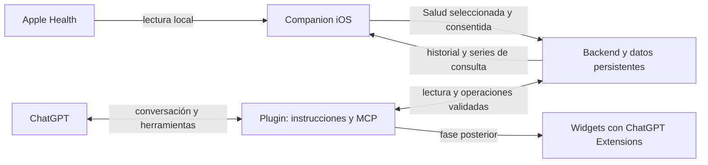

# Bocado Log — especificación de producto

Decisión de producto: **10 de octubre de 2026**. Repositorio: `peter7z/nutrition-tracker`.

Este documento define el nuevo enfoque y reemplaza el diseño de una app iOS con chat y registro propio. Describe el producto objetivo. La limpieza de iOS retira el registro propio; las integraciones de backend/plugin siguen pendientes. Los tickets y criterios de aceptación están en [backlog.md](backlog.md).

## Qué estamos construyendo

Bocado Log tiene una app companion iOS y un **plugin de ChatGPT** que comparten datos mediante un backend. La app ayuda a sincronizar Apple Health y a consultar gráficas, progreso e historial. Por ahora no se usa para registrar comidas, peso, ejercicio ni metas.

Toda entrada y corrección de tracking se realiza conversando con ChatGPT y usando el plugin. El plugin incluye herramientas MCP e instrucciones de uso; eventualmente tendrá widgets renderizados mediante **ChatGPT Extensions**, como tarjetas de calorías, peso y tendencias. El MCP es parte de esa integración, no la totalidad del producto.

La experiencia buscada es: hablar o escribir en ChatGPT, dejar que estime los nutrientes y registre lo consumido mediante herramientas, guardar medidas corporales con MCP, y abrir la app para ver los datos y la evolución. No queremos una base de alimentos ni pedir al usuario que introduzca los macros de cada alimento.

## Responsabilidades

| Componente | Responsabilidad |
|---|---|
| iOS | Leer HealthKit, sincronizar la copia autorizada, descargar tracking y visualizar Hoy, Datos y Progreso. La exportación de nutrición y de cintura a Apple Health es optativa y requiere permiso explícito. Cuenta, permisos, consentimiento y estado de sincronización. |
| ChatGPT | Conversación, voz/imágenes cuando el host las soporte, interpretación de la comida, estimación de nutrientes, preguntas y explicación de resultados. |
| Plugin | Identidad, paquete/manifiestos, instrucciones/skills y herramientas para leer y modificar datos. Futuras extensiones visuales dentro de ChatGPT. |
| Servidor MCP | Exponer herramientas de consulta y escritura del plugin con esquemas, autenticación y resultados estructurados. |
| Backend | Persistencia por propietario, validación, cálculos determinísticos, versiones, auditoría, idempotencia y API de consulta para iOS y el plugin. |
| Apple Health | Fuente de observaciones de Salud. iOS lee los tipos seleccionados y solo escribe nutrición o circunferencia de cintura cuando la persona activa esa sincronización. |

La importación técnica de Salud, la gestión de cuenta y el consentimiento no son registro manual de tracking. La escritura a Salud queda limitada a los flujos opcionales de nutrición y cintura; medidas corporales se registran con el plugin.

## Cómo debe ser la app iOS

La navegación se centra en **Hoy, Progreso, Datos y Ajustes/Salud**. Debe sentirse nativa, legible y sencilla, con español/inglés, Dynamic Type, VoiceOver y modo claro/oscuro.

**Inicio de sesión** es obligatorio para usar la app. Sin una sesión vigente se muestra únicamente la pantalla de entrada con Apple. Una sesión guardada vigente permite entrar directamente; cerrar sesión o recibir un rechazo por sesión vencida vuelve a la entrada.

**Hoy** muestra calorías y macros registrados, metas vigentes, diferencia y estado del día. Puede mostrar peso y actividad, diferenciados de la ingesta. Elegir otra fecha permite consultar el historial. Cada valor tiene procedencia y frescura; los nutrientes desconocidos no se convierten en cero.

**Progreso** muestra evolución de peso, tendencia/media móvil, calorías, macros y actividad por rango de fechas. Los huecos y la cobertura se hacen visibles. La actividad no aumenta automáticamente el presupuesto de comida. Los detalles y registros son de solo lectura.

**Datos** permite revisar el historial y las fuentes importadas o creadas desde el plugin. No permite editar ni borrar registros de tracking. Los conflictos de fuentes deben explicarse; las decisiones que cambian tracking se resuelven desde el plugin.

**Ajustes/Salud** permite conectar Apple Health, elegir tipos/rango, gestionar permisos y consentimiento, consultar la cuenta y cerrar sesión, sincronizar y revisar errores/última actualización. Desconectar o borrar la copia de Salud no borra los originales.

La app no incluye chat propio, botón para agregar comidas, dictado propio, cámara para registrar alimentos, editor de macros, catálogo, recetas, formularios de peso/ejercicio ni edición de metas. No presenta estado ni botones para cerrar/reabrir días. Puede explicar que el registro de consumo se hace en ChatGPT; no debe simular una integración ya disponible.

## Registro desde ChatGPT

Ejemplo de flujo:

1. La persona conecta su cuenta al plugin en ChatGPT.
2. Dice «comí 150 g de banana» mediante texto o voz si el host admite ese modo con el plugin.
3. ChatGPT estima kcal/macros y explicita supuestos. Solo pide identidad, cantidad, ingredientes o preparación cuando la falta de información afecta materialmente la estimación; no pide cargar nutrientes.
4. Una herramienta del plugin envía un registro estructurado. El backend valida propietario, cantidad, unidades, fecha, nutrientes y operación.
5. El servidor devuelve un recibo con ID, versión y los totales realmente registrados. ChatGPT informa el resultado después de ese recibo.
6. iOS actualiza su caché y refleja el mismo registro y totales.

«Eran 100 g» corrige la entrada identificada, con control de versión, sin añadir una segunda. Si hay varias candidatas, ChatGPT aclara cuál. Los reintentos de herramientas usan identidad de operación estable para no duplicar.

«¿Y si como una banana?» y «¿qué ceno?» consultan/proyectan y no crean consumo. Mostrar una tarjeta o una gráfica tampoco registra nada. Las acciones destructivas y cambios de metas conservan su política de autorización/confirmación; esa política no se reemplaza por texto generado o annotations del host. Registrar comidas no requiere confirmar ni cerrar el día.

Peso y actividad también pueden registrarse desde el plugin. Los datos importados de Salud mantienen su fuente y no se editan en Apple Health mediante esta integración. Los totales del día se calculan desde sus registros; no existe estado abierto/cerrado ni se bloquean correcciones al pasar la fecha.

## Datos y fuente de verdad

El backend es la fuente persistente del tracking creado desde ChatGPT. La conversación no es una base de datos: el plugin consulta los registros actuales antes de responder sobre totales o progreso. iOS tiene una caché de lectura y su copia local de Salud, no un segundo diario con ediciones independientes.

Se conservan cantidad/unidad, preparación, fecha de consumo, zona horaria, nutrientes y su base, supuestos, procedencia, propietario, versión y auditoría. Un snapshot de comida es un registro de consumo; no implica un catálogo de alimentos. Los cálculos de totales, conversiones y series se hacen en código y se comparten entre app, herramientas y widgets.

Apple Health sigue siendo la fuente original de Salud. Su copia remota contiene únicamente lo seleccionado y autorizado. Los datos de Salud, tracking y planilla se identifican por fuente; no se suman indiscriminadamente observaciones superpuestas ni resúmenes diarios sobre comidas. Ausencia de observaciones no significa cero ni permiso de lectura concedido.

Los objetivos tienen versiones y vigencia. Al primer registro de un nuevo día se guarda automáticamente un snapshot histórico del día anterior. Es solo una referencia: una corrección tardía actualiza los totales y agrega una versión al historial, sin reabrir nada. El paso de fecha o la existencia de comidas no demuestra que el registro esté completo; solo los totales explícitos de todo el día cuentan como completos para revisar cobertura. Las fechas relativas se resuelven en la zona horaria del usuario, inicialmente America/Montevideo.

## Sincronización y privacidad de Salud

La app requiere una sesión vigente; la lectura local de HealthKit puede funcionar sin conexión al backend una vez iniciada la sesión. Para que ChatGPT vea Salud hace falta un paso adicional: autorización explícita para enviar y almacenar una copia seleccionada en el backend y habilitar su consulta desde el plugin.

El consentimiento indica tipos, rango y finalidad, permite revisar qué se comparte y puede revocarse. Compartir no significa exportar toda HealthKit ni sus metadatos de dispositivo. Se transmiten observaciones normalizadas necesarias y agregados, con identificadores estables, procedencia, fechas y cobertura. Los scopes del plugin separan lectura de tracking, escritura y lectura de Salud autorizada.

La sincronización contempla altas, cambios y eliminaciones, lotes idempotentes, confirmaciones y cursores recuperables. Se ejecuta al abrir/volver a primer plano y manualmente; no se promete sincronización garantizada en segundo plano.

Revocar detiene futuras cargas y acceso del plugin a Salud; se ofrece borrar esa copia sin borrar tracking ni datos originales. En offline, iOS muestra la caché y su última actualización. ChatGPT solo conoce la última copia disponible: el servidor MCP no puede leer HealthKit directamente ni presentar un historial antiguo como datos en vivo.

## Plugin y futuras ChatGPT Extensions

El paquete privado Bocado Log ofrece herramientas de lectura y escritura con vinculación de cuenta. El servidor publica una extensión MCP Apps y una entrada global de solo lectura para abrir el resumen diario desde el sidebar de ChatGPT. La importación del paquete y la comprobación de esa entrada en una conversación real todavía requieren validación en el host.

El paquete `bocado-log/` contiene identidad, instrucciones/skills y configuración MCP. La tarjeta diaria inline y el resumen que abre el sidebar reutilizan los contratos del backend. Las vistas ampliadas de progreso siguen en el roadmap; no tendrán una base paralela ni cálculos distintos a iOS.

La fase posterior incluye:

- Tarjeta de calorías y macros del día, con metas y estado.
- Peso actual y tendencia, con fechas y cobertura.
- Gráficas de progreso por rango y detalles de fuentes.

Los widgets tendrán estados vacío/cargando/error/datos insuficientes, formatos locales y accesibilidad. Renderizarlos será una operación de consulta. Cualquier acción futura que escriba usará las herramientas existentes, autorización y recibos. Las APIs de Extensions, permisos y disponibilidad en móvil/voz se verifican al implementar; no se prometen superficies aún no probadas.

Las guías oficiales describen [MCP como servidor de herramientas del plugin](https://developers.openai.com/plugins/build/mcp-server), [OAuth para autenticar usuarios](https://developers.openai.com/plugins/build/auth), [conexión de un plugin personalizado](https://developers.openai.com/api/docs/guides/custom-mcp-server) y [UI dentro de ChatGPT](https://developers.openai.com/plugins/build/chatgpt-ui). La implementación elegirá la API vigente, sin exigir widgets para la primera versión privada.

## Entrega y límites

Primero Apple Health; luego backend/identidad/plugin y herramientas; después sincronización autorizada y companion de consulta; finalmente distribución y aceptación integral. Los widgets con Extensions son una fase posterior.

Quedan fuera del MVP: registro propio en iOS, chat o motor IA integrado en iOS, catálogo de alimentos/recetas, escritura en Apple Health, app Apple Watch, IA offline y garantía de background sync. La importación histórica de planilla se mantiene como tarea del backend/plugin, no como registro desde iOS.

La limpieza elimina las pantallas y clientes de registro del enfoque anterior, conservando esquemas y archivos para consultar el historial sin reescribirlo ni reproducir pendientes. Apple Health local sigue funcionando. El plugin, la API de lectura, la sincronización autorizada de Salud al servidor y TestFlight no están entregados. El peso medido en Apple Health forma parte explícita de esa futura sincronización al servidor (NUT-18). La planificación anterior está archivada para conservar decisiones y evidencia.
